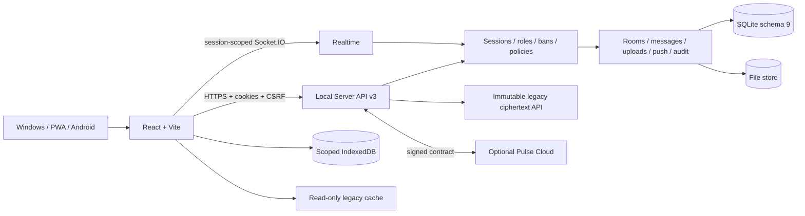

# Nexora

[](https://onmaynec.github.io/Nexora/)
[](https://github.com/Onmaynec/Nexora/actions/workflows/ci.yml)


[](LICENSE)

**Nexora** is a self-hosted messaging platform for Windows, browser/PWA and Android. It combines a Local Server, rooms and moderation, ordinary server-readable messaging, voice/media, offline synchronization, operations tooling and the optional Nexora Pulse commercial boundary.

> **Nexora 3.5.0 Mobile Continuity** is published as a normal GitHub Release with explicitly unsigned Windows and Android binaries. Installation is manual. Verify `SHA256SUMS.txt` before use. Automatic-updater metadata is intentionally excluded.

## Product status

| Line | Purpose | Distribution status |
|---|---|---|
| `3.5.0` | Mobile Continuity: replay/outbox, profile isolation, PWA lifecycle, Android hardening, privacy-safe push and resumable media | Normal latest GitHub Release; unsigned manual-download binaries |
| `3.4.0` | Stable Core source baseline: ordinary messaging, immutable legacy history, devices/sessions and backup verification | Source baseline merged into `main` |
| `3.3.3` | Goals, voice UX, Pulse purchase effects and MLS recovery | Published `UNSIGNED-TEST` prerelease |
| `3.1.2` | Messaging and Pulse production hardening | Last confirmed signed production baseline |

Authoritative 3.5.0 documents:

- [Release Notes 3.5.0](RELEASE_NOTES_3.5.0.md)
- [Release Verification 3.5.0](RELEASE_VERIFICATION_3.5.0.md)
- [Security Model](docs/SECURITY_MODEL.md)
- [Project Index](PROJECT_INDEX.md)
- [Documentation Portal](docs/README.md)

## Mobile Continuity

### Replay and offline outbox

- monotonic event sequence with bounded replay retention;
- reconnect validation before replay or controlled resync;
- per-conversation ordered outbox flush;
- idempotency and bounded retry;
- account/server-scoped cursors, drafts and queues;
- `RESYNC_REQUIRED` handling without draft loss;
- cross-profile cache isolation.

### PWA

- shell/static-only caching;
- API, Socket.IO, authenticated and `no-store` responses excluded;
- controlled install/update lifecycle;
- activation guard during uploads and voice recording;
- safe offline navigation;
- notification-open bridge.

### Android

- HTTPS-only profiles and cleartext-disabled WebView;
- TLS errors fail closed;
- same-origin navigation policy;
- deep links;
- contextual microphone and notification permissions;
- foreground/background/profile-switch cleanup.

### Push delivery

- device/account/server/installation-scoped subscriptions;
- AES-256-GCM token storage;
- generic preview by default;
- server-side access, mute and quiet-hours checks;
- HTTPS gateway with HMAC authentication;
- DNS pinning and private/reserved target rejection;
- durable retry/backoff and invalid-token revocation.

### Resumable media

- durable upload sessions and confirmed offsets;
- idempotent chunks;
- SHA-256 verification;
- actual MIME sniffing and executable rejection;
- quota, room-policy and access revalidation at completion;
- cancel, retry and TTL cleanup;
- client progress, abort and resume.

## Stable Core

### Ordinary messaging

- personal dialogs, Saved Messages and rooms;
- replies, threads, reactions, mentions, polls and bookmarks;
- edit/delete/forward/pin and scheduled/silent send;
- ordinary files, images and voice messages;
- IndexedDB cache and durable outbox;
- server-side authorization for REST and Socket.IO.

Ordinary chats no longer depend on Trust enrollment, MLS epoch synchronization or Welcome recovery.

### Legacy Trust/MLS history

Executable Trust Core, recovery routes, MLS transport, encrypted-upload write runtime, client MLS engine and the `ts-mls` dependency are removed.

Schema 8 remains as compatibility data while schema 9 adds Mobile Continuity storage.

- legacy conversations open in a read-only viewer;
- the server never decrypts legacy ciphertext;
- locally available historical plaintext may be read from readonly IndexedDB transactions;
- all legacy HTTP and Socket.IO writes return `LEGACY_READ_ONLY`.

### Rooms and administration

- roles `owner`, `moderator`, `member` and existing custom roles;
- atomic ownership transfer and moderator management;
- remove, ban/unban and ban list;
- join requests and invitations with expiration, usage limits and revocation;
- read-only, slow mode, announcement and pre-approval;
- restrictions for files, images and voice;
- administrative audit and system messages;
- active-ban fail-closed authorization.

### Backup and migration

- SQLite integrity checks and WAL handling;
- verified backup before schema migration;
- transactional and idempotent schema 9 upgrade;
- future-schema downgrade protection;
- backup verification without restore;
- staged restore with rollback;
- cleanup of temporary decrypted or staged data.

## Release distribution

The `v3.5.0` release publishes:

- `Nexora-Client-Setup-3.5.0-UNSIGNED.exe`;
- `Nexora-Server-Setup-3.5.0-UNSIGNED.exe`;
- `Nexora-Android-3.5.0-UNSIGNED.apk`;
- PWA and source ZIP archives;
- SPDX SBOM;
- unsigned-state evidence;
- SHA-256 checksums.

The release does **not** publish `latest.yml` or `server.yml`. Desktop automatic updates remain signature-enforced and therefore cannot use these unsigned packages.

A future signed build can reuse the existing fail-closed Authenticode and Android keystore paths.

## Architecture



Detailed architecture: [docs/ARCHITECTURE.md](docs/ARCHITECTURE.md).

## Development

Requirements:

- Node.js `22.16+`;
- npm;
- Java 17 and Gradle 8.13 for Android.

```bash
npm ci
npm run dev
```

Server only:

```bash
npm run dev:server
```

Web client only:

```bash
npm run dev:web
```

## Verification

```bash
npm run check
npm run test:unit
npm run test:performance
npm run audit:security
npm run release:consistency
npm run release:check
npm run test:soak
gradle -p android :app:assembleDebug --no-daemon
```

Signed local Windows packages require protected signing credentials:

```bash
npm run release:windows:signed
```

## Security boundary

The Local Server is authoritative for ordinary messages, sessions, rooms, roles, bans, upload policy, push policy, audit and realtime visibility. Every mutation validates authentication, Origin/CSRF, resource scope, membership/permission, ban/policy, input and resource limits before side effects.

The unsigned release changes only binary publisher identity. It does not disable TLS validation, certificate pinning, updater signature verification, authorization, upload validation or push-gateway SSRF protections.

See [Security Model](docs/SECURITY_MODEL.md) and [Security Policy](SECURITY.md).

## Documentation

- [Documentation Portal](docs/README.md)
- [Project Index](PROJECT_INDEX.md)
- [Architecture](docs/ARCHITECTURE.md)
- [Security Model](docs/SECURITY_MODEL.md)
- [Deployment](docs/DEPLOYMENT.md)
- [Operations Runbook](docs/OPERATIONS_RUNBOOK.md)
- [Administrator Guide](ADMIN_GUIDE.md)
- [Tester Guide](TESTER_GUIDE.md)
- [Release Policy](docs/RELEASE_POLICY.md)
- [Release Checklist](docs/RELEASE_CHECKLIST.md)

## License

[MIT](LICENSE)
