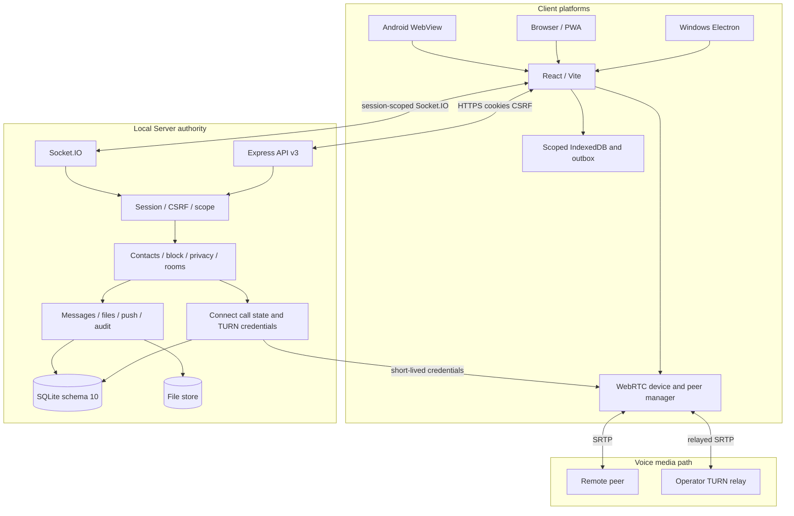

# Архитектура Nexora 3.6.0 Connect

## Scope and release state

This document describes the `release/3.6.0-connect` implementation candidate. It does not claim that `v3.6.0` is published.

- Application API: v3, extended additively;
- Local Server database: SQLite schema 10;
- writable core: ordinary server-readable messaging plus contacts/privacy/call metadata;
- media transport: WebRTC peer-to-peer or TURN relay;
- server-side media recording: absent;
- legacy Trust/MLS runtime: retired;
- legacy ciphertext history: immutable/read-only;
- stable publication: blocked until signed assets, external review and installed platform acceptance are complete.

## System view



## Authority split

### Client

The client owns rendering, input, local interaction state, device capability detection, microphone/output selection, peer-connection lifecycle, notification presentation and local cache. It may hide or disable unavailable actions, but that is never authorization.

The client must:

- bootstrap current access/version before replaying local work;
- use stable idempotency/client identifiers for retry-sensitive operations;
- display server error codes and `requestId` without internal details;
- close peer connections and stop media tracks on terminal, unmount, profile switch and session loss;
- handle duplicate realtime delivery without duplicate entities or notifications.

### Local Server

The Local Server owns:

1. authentication and active session/device scope;
2. Origin and CSRF checks for browser mutations;
3. resource existence and hidden-not-found behavior;
4. contact, block, privacy, room and account policy;
5. call participants and bound sessions;
6. state transitions, idempotency and durable metadata;
7. payload shape/size, quotas and sliding-window limits;
8. audit and privacy-filtered realtime delivery.

User-supplied user, server, room, conversation or call IDs locate candidate resources; they never authorize access by themselves.

## Composition root

`server/create-server-v31.cjs` remains the versioned composition root. Startup order is:

1. initialize the base Local Server and SQLite store;
2. apply existing schema 7 Pulse compatibility;
3. apply schema 8 legacy Trust compatibility;
4. apply schema 9 Mobile Continuity;
5. apply schema 10 Connect migration;
6. mount Stable Core and Mobile Continuity services;
7. mount Connect routes/realtime hooks;
8. start push/sync services;
9. listen on the network.

`server/connect.cjs` adds behavior through existing Express/Socket.IO/store boundaries. It does not create a second authentication or storage stack.

## Schema 10

`server/connect-schema10.cjs` performs an additive schema 9 → 10 migration before network listen.

### Tables

- `connect_privacy`: per-user presence, last-seen and read-receipt policy.
- `connect_call_history`: minimal terminal call metadata; no media/SDP/ICE.
- `connect_idempotency`: scoped response replay for retry-sensitive Connect mutations.
- `connect_audit`: bounded, content-safe operational audit entries.

### Invariants

- privacy values use SQLite `CHECK` constraints;
- call history states/outcomes use constrained enums;
- idempotency keys are unique by `(user_id, scope, key_hash)`;
- call-history indexes support each participant’s descending history query;
- idempotency expiry and audit actor/target indexes remain bounded/queryable;
- schema version is persisted in both SQL metadata and in-memory state metadata.

### Migration safety

The migration:

- rejects a database newer than supported schema 10;
- requires completed schema 9;
- runs source `integrity_check`;
- checks required free space;
- checkpoints WAL and creates a verified backup;
- executes `BEGIN IMMEDIATE` / `COMMIT` with rollback on error;
- verifies target integrity;
- patches replace/restore paths so restored older databases are upgraded before use.

## Contacts and privacy model

Contacts remain an additive social layer over existing DMs. Removing or blocking a contact does not delete message history; current access policy determines whether future direct operations are allowed.

Contact requests are server-owned state machines:

```text
pending -> accepted | rejected | cancelled | expired
```

Concurrent transitions serialize through the store mutation queue. An incompatible winner returns `STATE_CONFLICT`; an identical retry returns the saved/idempotent result.

Profile serialization uses relationship scope:

- self;
- current contact;
- shared room;
- blocked/hidden.

Only the permitted subset of status, bio, role, creation time and relationship information is returned.

## Presence and read receipts

Presence is derived from active authenticated sockets/sessions and emitted per viewer, not as one global unrestricted list.

- updates are coalesced;
- each payload has event/sequence/version metadata;
- privacy changes trigger a replacement snapshot without reconnect;
- disconnect removes a user only when no valid socket remains;
- block and hidden policy remove unauthorized subjects from future snapshots.

Read receipts use the reader’s current visibility policy at both boundaries:

1. history/message serialization (`readCount`);
2. realtime `conversation:read` emission.

A hidden receipt is not emitted and is not counted for an unauthorized viewer.

## Call state and signaling

Active call state is intentionally ephemeral and process-local. Terminal metadata is persisted to `connect_call_history`.

```text
ringing -> connecting -> active -> reconnecting -> active
ringing -> declined | missed | failed
connecting|active|reconnecting -> ended | failed
```

A call records caller/callee IDs, caller session, claimed callee session, deadlines and independent sequence/replay maps. The first eligible callee session atomically claims a ringing call; subsequent signaling and TURN requests require the exact bound session.

Signaling controls:

- authenticated Socket.IO only;
- participant and session scope on every event;
- strict `callId`, sequence and signal-kind validation;
- SDP/ICE shape and byte bounds;
- monotonically increasing sequence per participant;
- identical replay is idempotent;
- same sequence with different payload returns `CALL_STATE_CONFLICT`;
- bounded replay hashes and account/device/call rate windows;
- target delivery uses the bound session room.

## TURN boundary

The Local Server receives TURN URLs and secret from protected runtime configuration. The client never receives the static secret.

For an active, session-bound call, the server returns:

- short TTL;
- username containing expiry plus hashed user/session subject and call ID;
- HMAC credential;
- only configured STUN/TURN URLs.

Secrets, credentials, SDP and ICE candidates are excluded from call history, application audit and diagnostics.

## Realtime and revocation

Authenticated sockets join `session:*`, `user:*` and authorized conversation rooms. Connect additionally tracks sockets by user/session for presence and call revocation.

- block terminates calls between the two users;
- session disappearance terminates a bound call;
- invalid/disabled user or expired session fails `activeSession` checks;
- server shutdown emits a terminal call state before cleanup;
- current access is re-evaluated before subsequent REST/Socket.IO operations.

## Desktop and Android boundaries

Electron:

- isolates persistent storage by Local Server ID;
- pins Server ID/certificate fingerprint;
- denies untrusted IPC callers;
- allows notification and audio-only media permissions only for the active server origin;
- opens external origins in the system browser.

Android:

- accepts HTTPS Local Servers only;
- rejects TLS errors and mixed content;
- disables file/content access and third-party cookies;
- allows audio capture only for the active origin and Android `RECORD_AUDIO` permission;
- opens external HTTPS origins outside the WebView;
- cleans lifecycle state during background/profile switch/process recovery.

## Error and observability model

REST errors use a stable envelope:

```json
{
  "ok": false,
  "code": "CALL_STATE_CONFLICT",
  "message": "Safe user-facing message",
  "requestId": "correlation-id",
  "details": {}
}
```

Socket acknowledgements use the same code/details semantics. `RATE_LIMITED` includes `Retry-After` where HTTP applies and a safe retry delay in acknowledgement details.

Diagnostics expose capability and configuration state, not content:

- WebRTC signaling available;
- TURN configured/unconfigured;
- active-call boolean;
- selected device scope;
- explicit confirmation that content, candidates and user identifiers are excluded.

Metrics/log dimensions must remain bounded and must not use user IDs, call IDs, SDP, candidates, tokens or secrets as labels.

## Release architecture

Nexora 3.6.0 has a signed-stable-only release workflow. Publication requires approved machine-readable evidence and zero release blockers before packaging.

The workflow then:

1. checks the exact commit/version and external evidence;
2. requires protected Windows/Android signing material;
3. runs complete source/security/soak gates;
4. builds signed Windows installers, blockmaps and updater metadata;
5. builds and verifies the signed Android artifact;
6. builds source/PWA/SPDX assets;
7. performs installed-package smoke;
8. creates checksums and runtime evidence;
9. creates an immutable annotated tag;
10. publishes GitHub Release;
11. re-downloads and verifies every checksum/signature/container.

The candidate evidence intentionally prevents this workflow from publishing until independent review, production TURN, signing and cross-platform acceptance are complete.

## Residual constraints

- Process restart terminates active calls; only terminal call history is durable.
- WebRTC output-device selection depends on platform `setSinkId` support.
- Production call quality and NAT traversal require an operator-controlled TURN deployment.
- Windows↔Android/PWA and Android↔PWA acceptance requires physical/installed environments and cannot be inferred from source CI.
- Signed stable publication remains blocked until external evidence files are completed factually.
